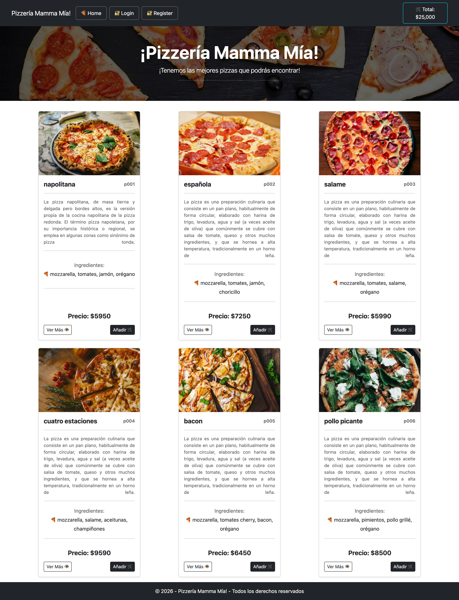
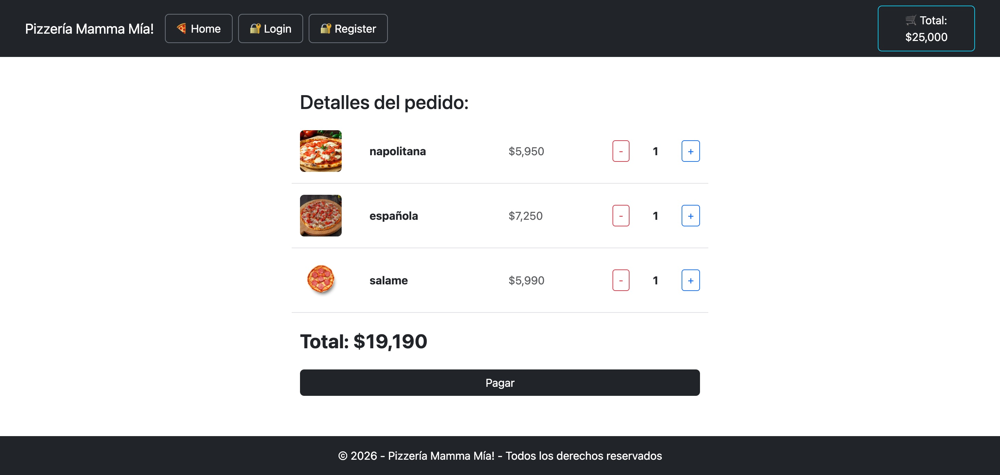
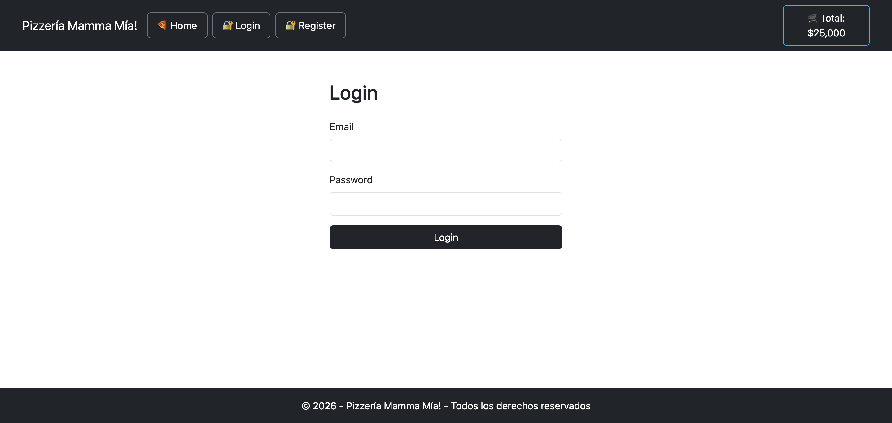
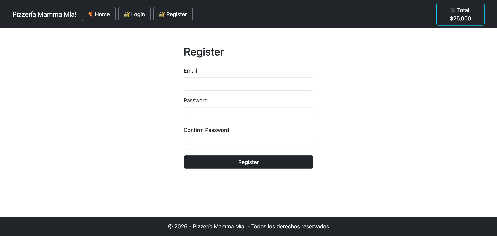
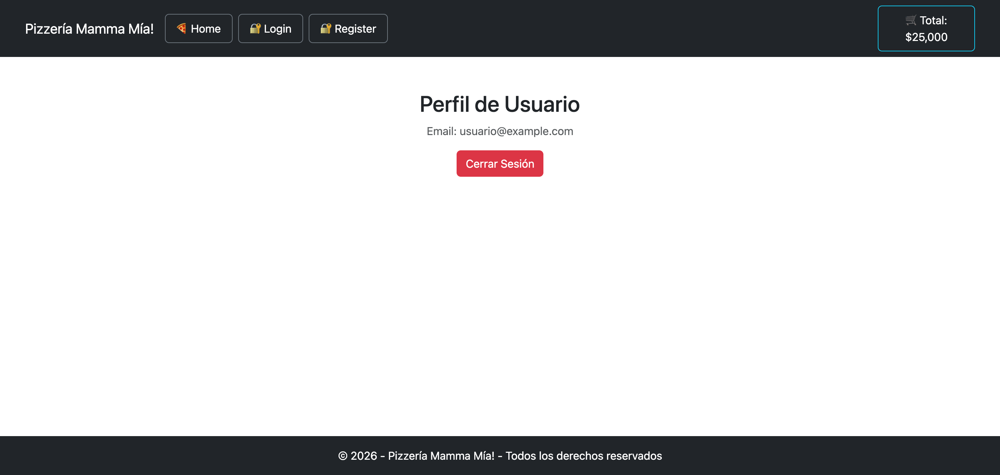
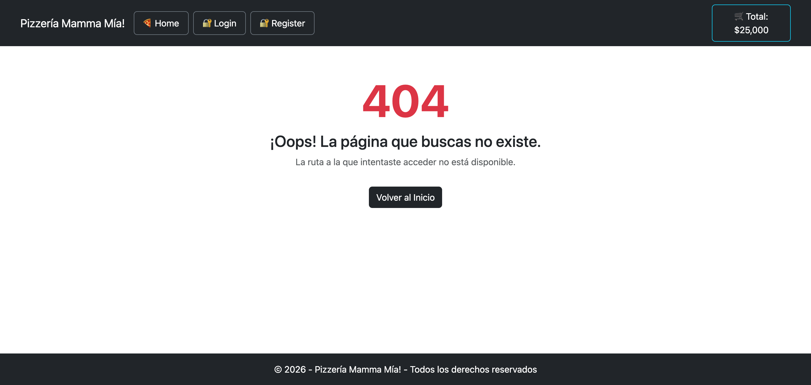
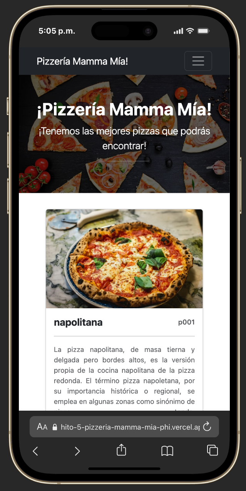

# 🍕 Pizzería Mamma Mía! - Hito 5 (React Router I)

¡Bienvenido al repositorio oficial del proyecto **Pizzería Mamma Mía!** correspondiente al **Hito 5** de la Academia de Talentos Digitales (Desafío Latam). En este hito, hemos implementado el sistema de enrutamiento utilizando **React Router DOM**, estructurando nuestra aplicación en múltiples páginas y vistas conectadas de forma dinámica y profesional.

---

## 📸 Previsualización de Vistas

### 🍕 Home (`/`)


### 🛒 Carrito de Compras (`/cart`)


### 🔐 Iniciar Sesión (`/login`)


### 📝 Registro (`/register`)


### 🔓 Perfil de Usuario (`/profile`)


### ❌ Página No Encontrada (`/404`)


### 📱 Vista en Dispositivos Móviles (Responsive)


---

## 🚀 Características y Requerimientos Implementados

1. **Configuración de React Router:** Instalación y configuración de `react-router-dom` envolviendo la aplicación raíz con `<BrowserRouter>` para gestionar la navegación web sin recargar la página.
2. **Estructura de Vistas (`pages`):** Organización modular de los componentes principales dentro de la carpeta `src/pages`:
   - `Home.jsx`: Vista principal con el catálogo de pizzas y el encabezado de presentación.
   - `Register.jsx`: Formulario de registro de usuario.
   - `Login.jsx`: Formulario de inicio de sesión de usuario.
   - `Cart.jsx`: Vista del carrito de compras interactivo con desglose de productos y cantidades.
   - `Pizza.jsx`: Vista de detalle individual para una pizza específica.
   - `Profile.jsx`: Vista de perfil de usuario (estática por ahora, previa a los hitos de autenticación JWT).
   - `NotFound.jsx`: Página de error 404 personalizada para rutas inexistentes.
3. **Sistema de Rutas (`App.jsx`):**
   - `/` ➔ Muestra el componente `Home`
   - `/register` ➔ Muestra el componente `Register`
   - `/login` ➔ Muestra el componente `Login`
   - `/cart` ➔ Muestra el componente `Cart`
   - `/pizza/p001` ➔ Muestra el componente `Pizza`
   - `/profile` ➔ Muestra el componente `Profile`
   - `/404` / `*` ➔ Muestra el componente `NotFound` (con enlace de redirección automática al inicio).
4. **Navegación Fluida (`Navbar`):** Componente de navegación interactivo construido con `react-bootstrap` y enlaces `<Link>` de `react-router-dom`, incluyendo el botón del total del carrito que redirige de forma obligatoria a la ruta `/cart`.

---

## 🛠️ Tecnologías y Librerías Utilizadas

- **React** (v18+) - Biblioteca principal de JavaScript para interfaces de usuario.
- **Vite** - Entorno de desarrollo ultrarrápido.
- **React Router DOM** (^6+) - Enrutamiento y navegación declarativa para aplicaciones de una sola página (SPA).
- **React Bootstrap** & **Bootstrap 5** - Framework CSS y componentes adaptativos.
- **Git & GitHub** - Control de versiones y colaboración.
- **Vercel** - Plataforma de despliegue continuo en la nube.

---

## 📦 Instalación y Ejecución Local

Si deseas clonar y probar este proyecto en tu entorno local, sigue los siguientes pasos:

1. Clona el repositorio:
   ```bash
   git clone https://github.com/tu-usuario/hito-5-pizzeria-mamma-mia.git
   ```

2. Entra al directorio del proyecto:
   ```bash
   cd hito-5-pizzeria-mamma-mia
   ```

3. Instala las dependencias necesarias:
   ```bash
   npm install
   ```

4. Ejecuta el servidor de desarrollo local:
   ```bash
   npm run dev
   ```

5. Abre tu navegador web en la dirección indicada por Vite (usualmente `http://localhost:5173`).

---

## 📋 Autor
**Jorge** - *Desarrollador Frontend Junior* 🚀